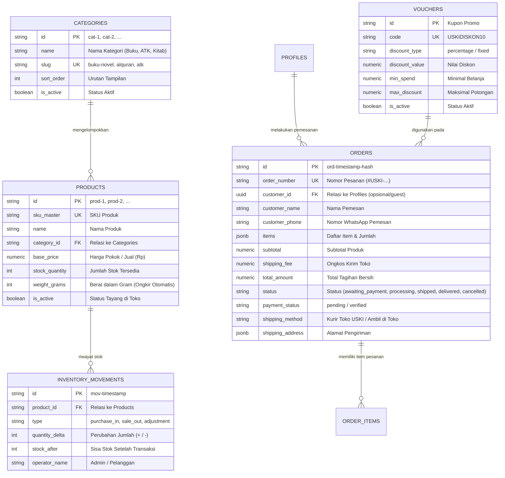

# DOKUMENTASI STRUKTUR DATABASE RESMI USKI STORE
**Platform:** PostgreSQL 15 via Supabase Cloud  
**Keamanan:** Row-Level Security (RLS) + Enkripsi SSL + UUID Validation  
**Real-time:** Supabase Realtime Channel (`public:live_sync`)

---

## 1. Diagram Relasi Antar Tabel (Entity Relationship)

---

## 2. Jaminan Keamanan & Integritas Data

1. **Row Level Security (RLS)**:
   - Setiap tabel dilindungi oleh aturan RLS PostgreSQL sehingga transaksi dari pelanggan hanya dapat membaca data yang sah dan membuat pesanan baru secara aman.
   - Hak istimewa pengubahan data penting (stok, status pesanan, verifikasi pembayaran) hanya dapat dilakukan oleh Admin yang terautentikasi.

2. **Perhitungan Otomatis Berat & Ongkos Kirim**:
   - Setiap produk memiliki kolom `weight_grams` yang tervalidasi (> 0).
   - Di checkout, sistem menjumlahkan `totalWeight = sum(weight_grams * qty)`.
   - Logika ongkos kirim: `Math.ceil(totalWeight / 1000) * 10.000` (Rp 10.000 per 1 kg) untuk Kurir Toko USKI, dan Rp 0 untuk Ambil Sendiri di Toko.

3. **Sinkronisasi Stok Otomatis (Audit Trail)**:
   - Setiap kali terjadi pesanan baru (checkout), sistem otomatis mengurangi `products.stock_quantity` dan mencatatnya ke tabel `inventory_movements` dengan tipe `sale_out` secara atomik.

4. **Pembersihan Data Otomatis**:
   - Skrip pemeliharaan database (`scripts/tidy_database.mjs`) disediakan untuk membersihkan data uji (*test fixtures*) dan menjaga konsistensi relasi foreign key secara berkala.
